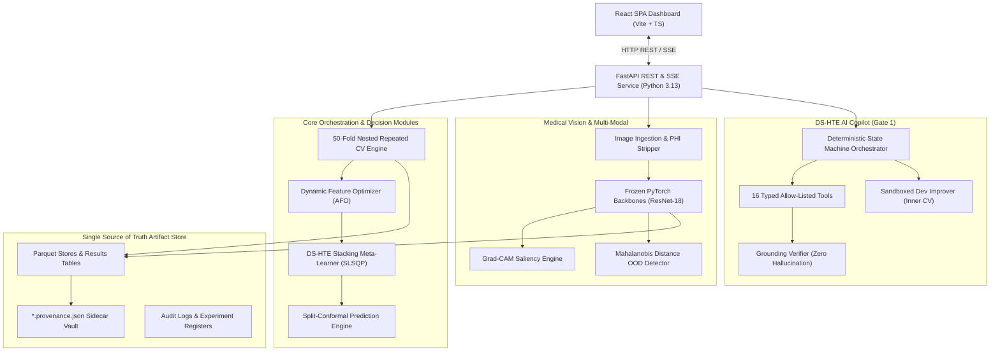
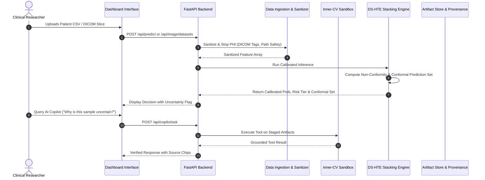
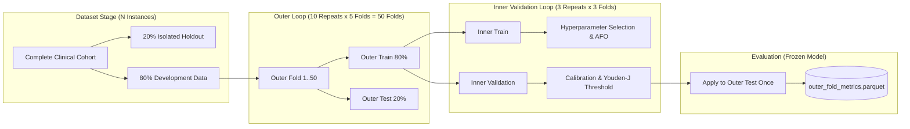
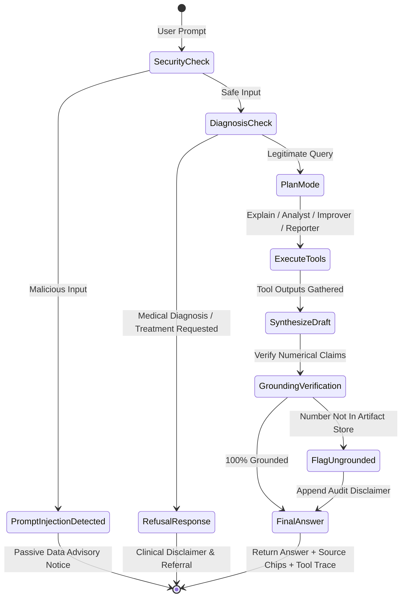

# System Architecture & Technical Specifications

> **System Notice**: Research prototype, not a certified clinical diagnostic device.

---

## 1. High-Level System Architecture

---

## 2. End-to-End Data Flow & Ingestion

---

## 3. 50-Fold Nested Repeated Cross-Validation Protocol

---

## 4. AI Copilot Orchestrator Architecture

